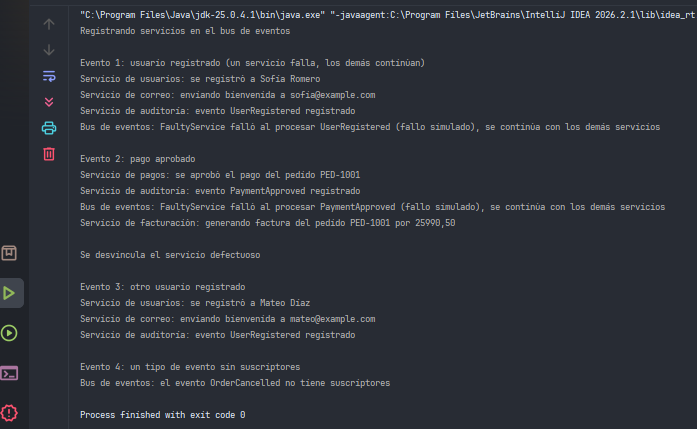

# Ejercicio 09 - Motor Avanzado de Eventos para Arquitectura de Microservicios Simulada

## Descripción

Una plataforma distribuida simulada necesita un bus de eventos centralizado donde servicios independientes se registran para escuchar cambios de estado globales (como `UserRegistered` o `PaymentApproved`) y ejecutan acciones asíncronas de forma desacoplada.

## Objetivos

- Combinar el patrón Observer con un bus de eventos centralizado.
- Despachar cada evento solo a los servicios registrados para su tipo.
- Controlar suscripciones bajo alta concurrencia.
- Aislar los errores de cada observador para que un fallo no afecte a los demás.

## Implementación del patrón Observer

Se usa la variante de bus de eventos con enrutamiento por tipo.

- **Sujeto / mediador:** `EventBus` mantiene un `ConcurrentHashMap` indexado por tipo de evento, con un `CopyOnWriteArrayList` de observadores por cada tipo.
- **Evento:** `Event` es un `record` con el tipo y un payload inmutable.
- **Observador:** `EventObserver` declara `onEvent(Event event)`.
- **Publicadores:** `UserService` y `PaymentService` publican eventos en el bus.
- **Observadores concretos:** `WelcomeEmailService`, `InvoiceService`, `AuditService` y `FaultyService`.
- **Asincronía:** cada entrega se ejecuta en un `ExecutorService` y `publish` devuelve un `CompletableFuture`.
- **Robustez:** cada entrega tiene su propio `try-catch`. `FaultyService` lanza excepciones a propósito y los demás servicios siguen funcionando.

## Propósito de la clase

- `EventTypes`: constantes con los tipos de evento.
- `Event`: mensaje estructurado.
- `EventObserver`: interfaz común de los servicios.
- `EventBus`: bus centralizado con enrutamiento, asincronía y aislamiento de errores.
- `UserService` y `PaymentService`: servicios que publican eventos.
- `WelcomeEmailService`, `InvoiceService` y `AuditService`: servicios que reaccionan.
- `FaultyService`: servicio defectuoso para probar la robustez.
- `Main`: registra servicios, publica eventos y desvincula al servicio defectuoso.

## Concepto clave

El bus indexa los observadores por tipo de evento, así que cada mensaje llega solo a quien lo necesita. Los publicadores y los consumidores no se conocen entre sí, y un error en un consumidor queda contenido.

## Resultado

## Conclusión

Un bus de eventos con Observer permite construir servicios muy desacoplados, asíncronos y tolerantes a fallos. Sumar un nuevo servicio solo requiere implementar `EventObserver` y suscribirlo al tipo de evento deseado.
